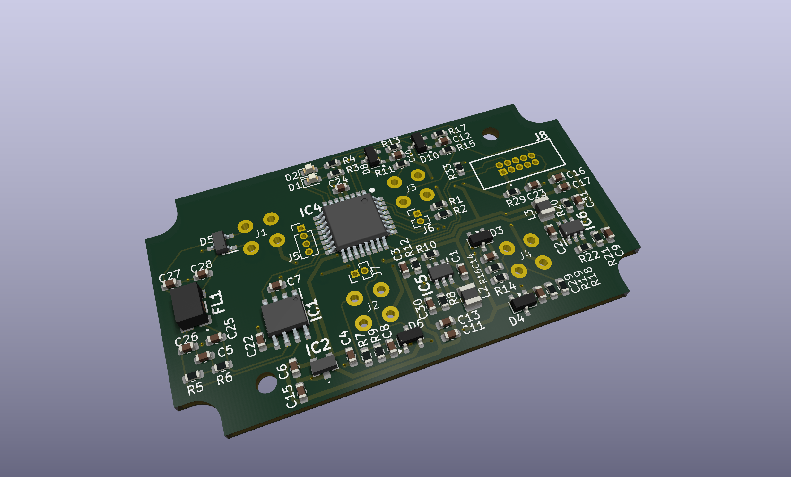
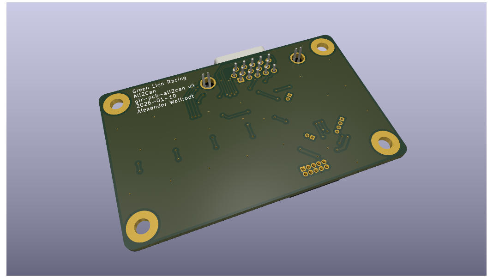
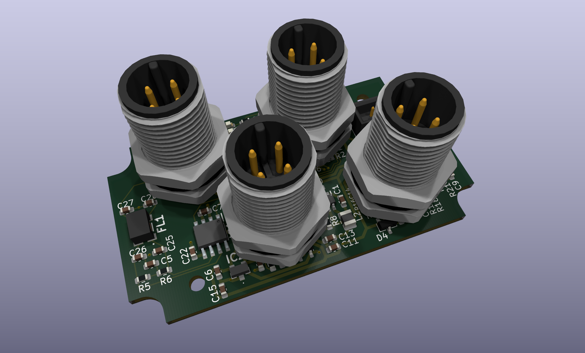

# glr-pcb-all2can

This is a KiCad PCB repository for the [All2Can](https://github.com/green-lion-racing/glr-all2can) software.

  
  

  

## Overview

This PCB is intended to collect sensor data and provide that to can.

The connector is D-Sub 15-pin male.  
It supports a 24V power supply voltage.  
One CAN (up to 5 MB/s) connection.  
Uses a `STMSTM32C092KCT6` microcontroller (250kbytes Flash 36kbytes Ram).  
It also preserves space for an 6-axis IMU `LSM6DSV16BXTR`.  

There are 7 analog/digital inputs (input voltage level is configurable by a voltage divider).  
And 4 digital outputs (5V level).

Provides headers for SPI, I2C, UART.

## History

This PCB is actually the fourthst generation of this type used for our team.

1. [Frist version](https://circuitmaker.com/Projects/Details/Pat-Her/All2Can-V01) in CircuitMaker.  
   By [PatHer777](https://github.com/PatHer777).

2. [Second version](https://circuitmaker.com/Projects/Details/Jannis-Dohm/All2Can) also in CircuitMaker with some changes.  
   By Jannis Dohm.

3. Third in Fusion 360, with new PCB design.  
   By Alexander Wallrodt.

4. Now [fourth version](https://github.com/green-lion-racing/glr-pcb-all2can) in KiCad, with some changes to schematic and smaller PCB.  
   By Alexander Wallrodt.

5.  Fifth version is fitted to a Bopla Bolink Case. 
   By Alexander Wallrodt.
